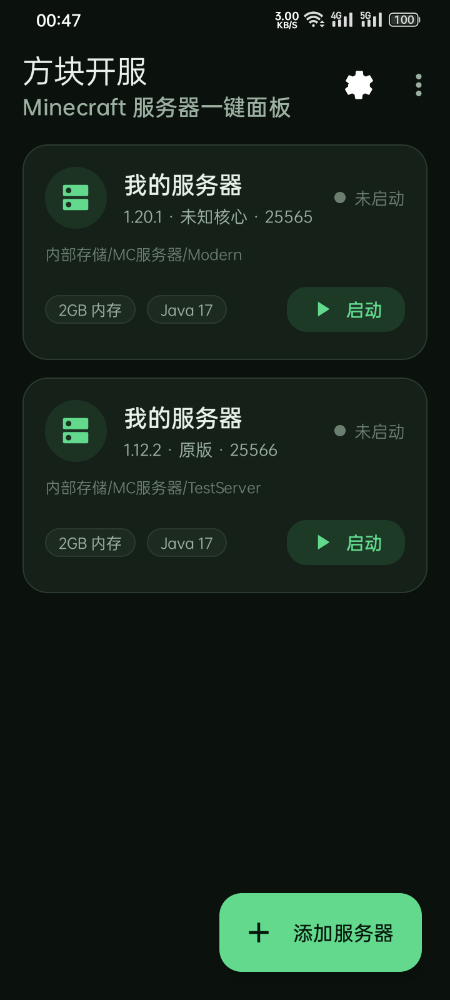
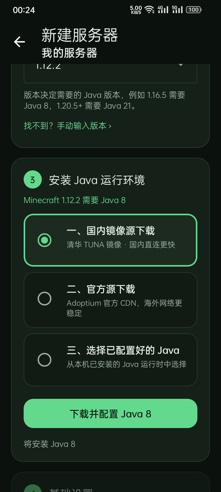
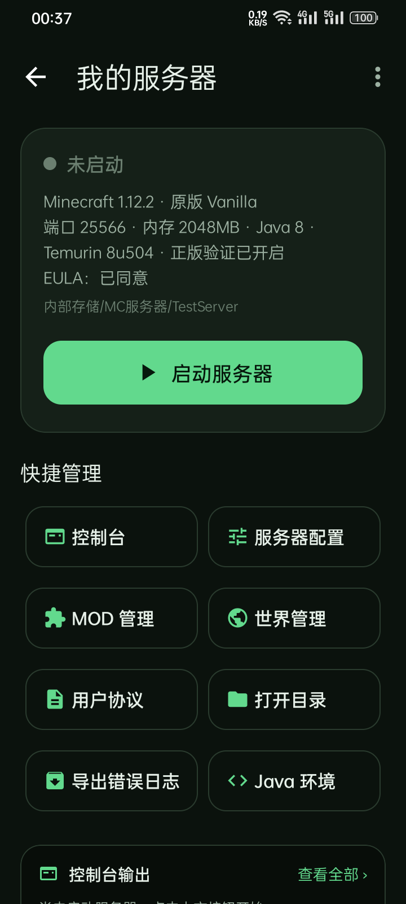
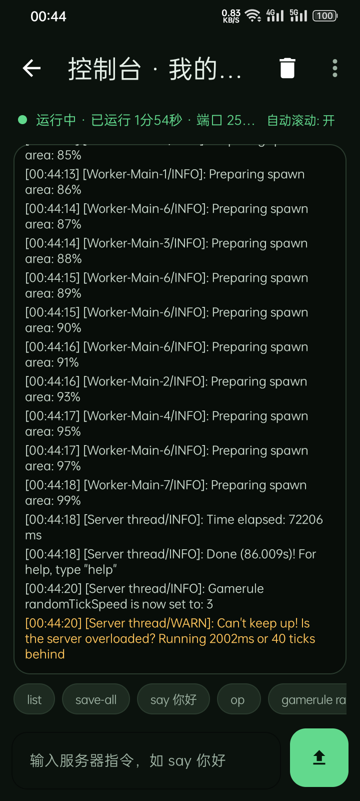
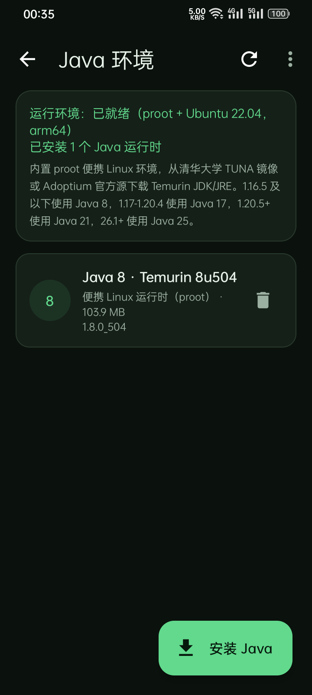
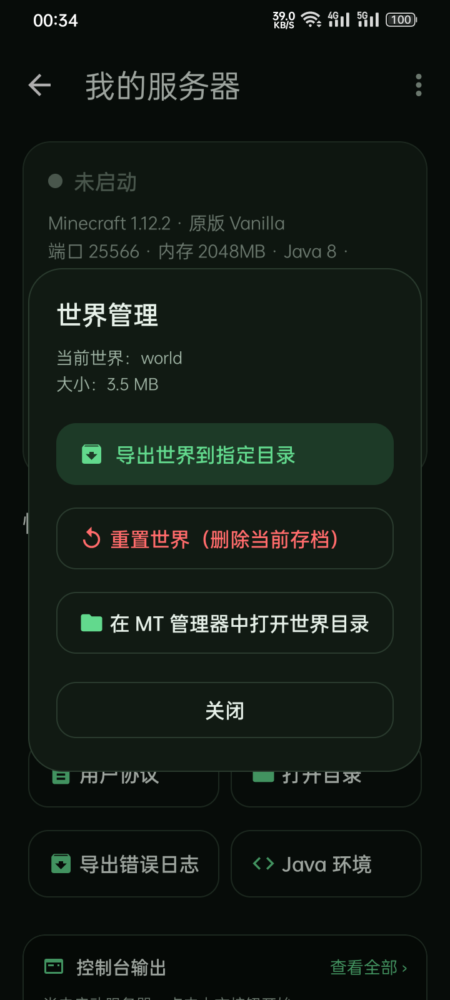

# 方块开服 · Minecraft 服务器一键面板

[](LICENSE)
[](https://github.com/LinYuxia-YC/mc-server-panel)
[](https://github.com/LinYuxia-YC/mc-server-panel)

面向 **arm64 安卓手机（Android 7.0+）** 的 Minecraft Java 版服务器管理面板。
导入服务端核心，选好 MC 版本，面板会自动准备对应的 Java 运行环境，然后一键开服。

> 作者：**YuXiaYC** ｜ 开发协助：**DeepSeek Harness** ｜ 许可证：**AGPL-3.0**
> 仓库：<https://github.com/LinYuxia-YC/mc-server-panel>

> 已在 OPPO PFVM10（Android 12，arm64）真机验证：
> 原版 1.12.2 + Java 8（Temurin 8u504）与 原版 1.20.1 + Java 17（Temurin 17.0.20.1）均可正常启动、监听端口、在控制台收发指令。
> 直接安装包：`方块开服-v1.0.0-arm64.apk`（约 5.9 MB）。

## 界面预览

| 服务器列表 | 导入核心 / 选择 Java |
| --- | --- |
|  |  |

| 服务器面板 | 实时控制台 |
| --- | --- |
|  |  |

| Java 环境管理 | 世界管理 |
| --- | --- |
|  |  |

## 真机验证记录

| 项目 | 结果 |
| --- | --- |
| 原版 1.12.2（Java 8 / Temurin 8u504 / proot） | ✅ `Done (24.026s)`，25565 监听，控制台 `list` 正常返回 |
| 原版 1.20.1（Java 17 / Temurin 17.0.20.1 / proot） | ✅ `Done (86.009s)`，25566 监听，控制台输出正常 |
| 三种 Java 方式 | ✅ 国内镜像下载安装、已安装运行时选择、更换 Java 均通过 |
| 配置 | ✅ 端口 25565→25566、随机刻 3→5（启动后自动 `gamerule`）、MOTD 中文、正版验证开关写回 `server.properties` |
| MOD 管理 | ✅ 开关重命名 `.jar` ⇄ `.jar.disabled`，标签页切换 |
| 世界管理 | ✅ 导出 zip、备份并重置（生成 backups zip，删除 world，重启后重新生成 `Done 20.512s`） |
| 错误日志导出 | ✅ 生成 `错误日志-*.zip`，含 latest.log / gz 归档 / panel 日志 / properties / 设备信息 |
| MT 管理器联动 | ✅ 直接唤起 `bin.mt.plus` 并定位到服务器目录 |
| EULA | ✅ 查看 / 同意 / 编辑 eula.txt |


---

## 功能

| 需求 | 实现 |
| --- | --- |
| 自定义服务器目录 / 添加服务器目录 | 新建服务器时选择或新建任意目录；也可在「设置 → 默认服务器根目录」修改默认位置；主界面支持导入已有服务器目录 |
| 导入服务器核心 | 内置文件选择器选择任意 `.jar`，自动识别 Paper / Purpur / Spigot / CraftBukkit / 原版 / Forge / NeoForge / Fabric / Quilt / Cauldron 与 MC 版本 |
| 导入核心后选择 MC 版本 → 三种 Java 方式 | ① 中国大陆镜像源（清华 TUNA）② 官方源（Adoptium / Ubuntu CDN）③ 选择本机已配置好的 Java。选择后自动下载、解压、校验并绑定到该服务器 |
| 快捷打开 EULA、用 MT 管理器打开目录 | 「用户协议」可查看/同意 EULA 并直接编辑 `eula.txt`；「打开目录」通过 `resource/folder` Intent 直接唤起 MT 管理器定位到服务器目录 |
| 快速编辑 MOD | MOD / 插件双列表，开关即重命名（`.jar` ⇄ `.jar.disabled`），支持导入、删除、跳转 MT（兼容 `.dsible` 等旧后缀） |
| 快速编辑服务器配置 | 端口、世界种子、随机刻、玩家默认模式、世界默认难度、分配内存，另含 MOTD、最大玩家数、视距；可切换到原始 `server.properties` 编辑 |
| 一键开关正版验证 | 配置页开关直接改写 `online-mode`，运行中会提示重启生效 |
| 一键重置世界 | 支持「备份并重置」或「直接重置」，自动处理 `world`、`world_nether`、`world_the_end` |
| 一键导出世界 | 选择任意目录，将世界打包为 zip |
| 一键启动服务器 / 导出报错日志 | 前台服务 + CPU/WiFi 唤醒锁保活；实时控制台、指令输入；「导出错误日志」把 `latest.log`、崩溃报告、面板日志、配置等打成 zip 保存到任意目录 |

其它细节：

- 服务器启动完成后（检测到 `Done (`）自动下发 `gamerule randomTickSpeed <值>`，随机刻设置即时生效。
- 低版本（≤1.12.2）自动使用数字型 `gamemode` / `difficulty`，高版本使用名称型，无需手动改配置。
- 中文 MOTD 按 Java Properties 规则写成 `\uXXXX`，避免游戏内乱码；读取历史乱码也能自动修复。
- 面板日志会以 UTC+8 时区输出，与手机时间一致。

---

## Java 版本对照

| Minecraft 版本 | 需要 Java |
| --- | --- |
| ≤ 1.16.5 | Java 8 |
| 1.17 | Java 16（本面板使用兼容的 Java 17） |
| 1.18 – 1.20.4 | Java 17 |
| 1.20.5 – 1.21.x | Java 21 |
| 26.1+（2026 年起的版本号） | Java 25 |

面板内置 Java 8 / 17 / 21 / 25 四个 Temurin JRE（aarch64 Linux 版本），
运行在 **proot + Ubuntu 22.04 base** 的便携环境中。

---

## 技术架构

```
┌──────────────────────────── Android App（Kotlin, targetSdk 28）────────────────────────────┐
│ MainActivity / SetupActivity / ServerActivity / ConsoleActivity / ConfigActivity / ...      │
│                                                                                             │
│  ServerRunner ── ProcessBuilder ──► proot ──► Ubuntu rootfs ──► /opt/jreN/bin/java ──► server.jar
│        │                              ▲                                                     │
│        │                              └── proot / libtalloc / libandroid-shmem（APK 内置）  │
│        └── 前台 Service + WakeLock + WifiLock，日志环形缓冲、崩溃日志导出                     │
│                                                                                             │
│  JavaManager ── 下载（TUNA / Adoptium）→ 解压（tar.gz / tar.xz / zip / deb）→ proot 校验    │
└─────────────────────────────────────────────────────────────────────────────────────────────┘
```

为什么需要 proot？

- Android 10+ 对 `targetSdk >= 29` 的应用禁止执行应用数据目录中的二进制，因此本应用固定 `targetSdk 28`。
- Android 12 起 arm64 用户态地址空间变为 39-bit，旧版 bionic OpenJDK 8 在启动时会崩溃
  （`assembler_aarch64.hpp: Field too big for insn`）。
- 采用 Termux 同款的 proot + Ubuntu 根文件系统方案，运行标准 glibc Temurin JDK，
  在 Android 7–15 上表现一致，且能同时覆盖 Java 8 / 17 / 21 / 25。

安装 Java 时下载的内容：

| 组件 | 中国大陆镜像源（默认） | 官方源 | 大小 |
| --- | --- | --- | --- |
| Ubuntu base rootfs | 清华 TUNA `ubuntu-cdimage` | cdimage.ubuntu.com | ≈ 27 MB |
| Temurin JRE 8/17/21/25 | 清华 TUNA `Adoptium` | Adoptium API（GitHub） | 39–52 MB |
| proot / libtalloc / libandroid-shmem | APK 内置 | APK 内置 | < 0.5 MB |

---

## 构建

环境：

- JDK 17
- Android SDK Platform 34、Build-Tools 34.0.0
- Gradle 8.7（仓库自带 wrapper，默认使用腾讯镜像分发地址）

```bash
# 1. 配置 SDK 路径
echo "sdk.dir=/path/to/android-sdk" > local.properties

# 2. 构建 release APK
./gradlew assembleRelease        # Windows: gradlew.bat assembleRelease

# 产物：app/build/outputs/apk/release/app-release.apk
```

签名是可选的：仓库**不包含**任何签名密钥。没有 `app/release.jks` 时会自动使用 debug 签名。
正式发布前请自行生成密钥并以环境变量提供密码：

```bash
keytool -genkeypair -v -keystore app/release.jks -keyalg RSA -keysize 2048 \
        -validity 10950 -alias mcpanel -storepass "你的密码" -keypass "你的密码" \
        -dname "CN=McPanel, OU=McPanel, O=McPanel, L=Beijing, ST=Beijing, C=CN"

export MCPANEL_STORE_PASSWORD="你的密码"
export MCPANEL_KEY_ALIAS="mcpanel"
export MCPANEL_KEY_PASSWORD="你的密码"
./gradlew assembleRelease
```

`targetSdk = 28` 是刻意设置，原因见上文；Android 14+ 仍然允许安装该 targetSdk 的应用。

---

## 使用流程

1. 打开应用，允许存储权限（Android 11+ 直接使用旧版存储模型，无需 MANAGE_EXTERNAL_STORAGE）。
2. 点「添加服务器」→ 输入名称 → 选择目录（可现场新建）。
3. 「选择 .jar 文件」导入服务端核心，面板会自动识别核心类型和 MC 版本。
4. 确认/修改 MC 版本 → 选择三种 Java 方式之一：
   - 国内镜像：从清华 TUNA 下载，速度最快；
   - 官方源：Adoptium / Ubuntu 官方；
   - 已配置好的 Java：直接选本机已安装的运行时。
5. 设置内存、端口、正版验证、同意 EULA → 「完成创建」。
6. 在服务器页点「启动服务器」，可在「控制台」里输入指令。
7. 长按主界面服务器卡片可继续配置、重命名、用 MT 打开目录或删除服务器。
8. 需要备份时用「世界管理 → 导出世界」，出问题时用「导出错误日志」把 zip 发给服主排查。

> 首次启动 1.20+ 服务器时，世界生成可能需要几分钟（手机 CPU 与 proot 开销），请耐心等待控制台出现 `Done`。
> 建议在系统设置中允许本应用「忽略电池优化」，并把应用锁在后台，避免服务器被系统清理。

---

## 目录结构

```
app/src/main/java/com/mcpanel/
├── App.kt                     Application、通知渠道、StrictMode 文件 URI 放行
├── MainActivity.kt            服务器列表 / 新建 / 导入已有目录
├── SetupActivity.kt           导入核心 → 选版本 → 三种 Java 方式 → 基础设置
├── ServerActivity.kt          仪表盘、启停、世界管理、EULA、日志导出、MT 联动
├── ConsoleActivity.kt         实时控制台 + 指令输入 + 快捷指令
├── ConfigActivity.kt          端口/种子/随机刻/模式/难度/内存/正版验证
├── ModsActivity.kt            MOD 与插件管理
├── JavaActivity.kt            Java 运行时安装、导入、删除
├── TextEditorActivity.kt      eula.txt / server.properties 等文本编辑
├── SettingsActivity.kt        默认目录、下载源、电池优化、许可说明
├── core/
│   ├── JavaManager.kt         下载/解压/校验/删除 Java
│   ├── Proot.kt               proot 环境、启动命令、resolv.conf
│   ├── ServerRunner.kt        进程管理、日志环形缓冲、指令输入、崩溃检测
│   ├── ServerService.kt       前台服务 + WakeLock/WifiLock
│   ├── ServerOps.kt           目录准备、properties 读写、世界重置/导出
│   ├── CoreDetector.kt        核心类型与版本识别（含 1.20+ bundler jar）
│   ├── Extractor.kt           tar.gz / tar.xz / zip / deb 解压（含符号链接/权限）
│   ├── Downloader.kt          断点续传、多镜像回退、进度回调
│   ├── PropertiesFile.kt      properties 保序读写、转义/反转义、乱码修复
│   └── ...
└── ui/                        文件选择器、列表适配器、通用对话框
```

内置资源：

```
app/src/main/assets/proot/
├── bin/proot
├── lib/libtalloc.so.2
├── lib/libandroid-shmem.so
└── libexec/proot/loader, loader32
```

---

## 已知限制

- 仅支持 **arm64-v8a** 设备（32 位 ARM / x86 模拟器不在支持范围）。
- 便携环境首次安装约需 70 MB 下载 + 约 250 MB 磁盘；Java 运行时按需安装。
- 服务器运行在 proot 中，CPU 密集场景有少量额外开销；首次生成世界会比桌面端慢。
- 正版验证需要设备能访问 Mojang 会话服务器；国内网络下建议保持离线模式。
- 仅管理 Java 版服务端，不涉及基岩版。

---

## 开源组件与许可

- AndroidX / Material Components — Apache License 2.0
- Kotlin Coroutines — Apache License 2.0
- Gson — Apache License 2.0
- Apache Commons Compress — Apache License 2.0
- XZ for Java — Public Domain
- proot — GNU GPL v2（<https://proot-me.github.io/>）
- libtalloc — GNU LGPL v3
- libandroid-shmem — Apache License 2.0
- Ubuntu Base rootfs — 由用户按需下载，遵循 Ubuntu 许可
- Eclipse Temurin (OpenJDK) — GNU GPL v2 + Classpath Exception，由用户按需下载

本项目不包含任何 Minecraft 游戏文件或服务端核心，核心由用户自行导入；
Minecraft 相关权利归 Mojang / Microsoft 所有。

---

## 许可证

本项目以 **GNU Affero General Public License v3.0（AGPL-3.0）** 授权发布。
完整文本见 [LICENSE](LICENSE)，或访问 <https://www.gnu.org/licenses/agpl-3.0.html>。

```
方块开服 · Minecraft 服务器一键面板（McPanel）
Copyright (C) 2026 YuXiaYC

Author / 作者：YuXiaYC
Development assistance / 开发协助：DeepSeek Harness
```

如果你修改本项目并通过网络提供服务，AGPL-3.0 要求你向用户提供对应的完整源代码。

第三方组件的许可证与版权归其各自作者所有，详见 [NOTICE](NOTICE)。

